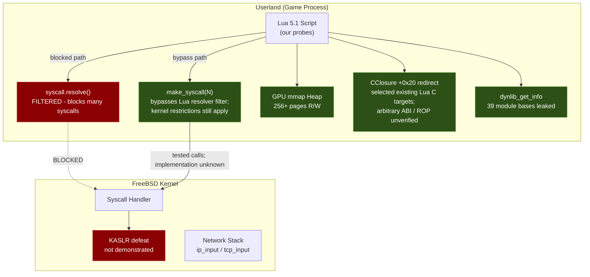
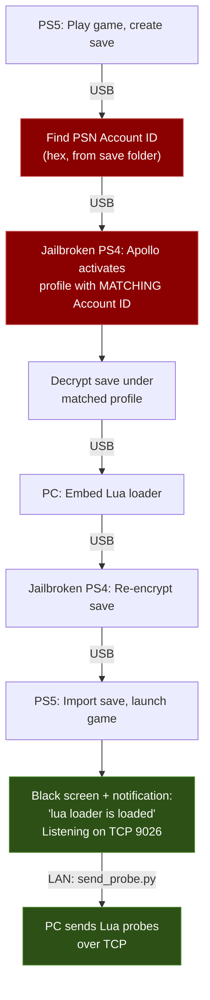

# PS5 Firmware 14.10 - Kernel Research

Open community kernel exploit research on PlayStation 5 firmware **14.10**, conducted via a userland Lua 5.1 loader on TCP 9026.

> **Goal:** Establish a reproducible 14.10 kernel primitive, then assess whether it can support kernel R/W and hypervisor research. None of those kernel-side stages is currently demonstrated.

---

## Funding — PLEASE DONATE

> **Previous goal met (2026-10-18):** The Claude 20x subscription goal was reached and the subscription has been purchased. The extra usage is already being put to work — running parallel sub-agents to accelerate research. Thank you to everyone who contributed!

<a href="https://www.paypal.me/SalwanStudios">

</a>

> **When donating via PayPal, please send as Friends & Family** (not Goods & Services) to avoid payment holds and fees.

### Thank You to Our Donors

These people believed in this research and put their money where their mouth is. It means the world &lt;3

```
Ivan Milinski · Felix Dietz · Brian Alejandro Camacho · Jonathan Moreau · Frank Munsche · Mohammed Kazi · Ismael Jesus · Cassidy Poynter · Mohammad Islam · Flix Rely · Paul E Fox · K Lam · Sean Verkempinck
```

### Contributors

- **[ng643](https://github.com/ng643)** (Rithik Janarthanan) — PRs #6-8, #11-18, #21-27, #37, #39, #40, #44, #55-57: Evidence corrections, sysctl MIB fixes, Tier 1/2/3 handler claim audits, CVE assessments (49412, 49419), kevent/430 corrections, kldsym probe, thr_create(430) full decode, kevent timeout matrix, sys 622 bitmap correction, AIO scope correction, remaining CVE triage, Byepervisor scene retraction, syscall label table correction (153 entries), WebKit OOB length-window audit, 14.10 WebKit engine fingerprint + metadata overflow ceiling, WebKit crash corpus harvester, 54f_kaslr_deep dossier audit, p161 blob runtime measurement
- **[AJV20](https://github.com/AJV20)** — PRs #47-54: PowerShell capture path fixes (cross-platform), CI bounded hardware-free verification, ledger JSON validation, p161 chunk regression coverage, ledger-to-artifact binding, AIO/kevent evidence summary reconciliation, colliding capture preservation, failed evidence pair cleanup
- **[4TheDoctor](https://github.com/4TheDoctor)** (The Doc) — PRs #19-20, #28: CVE-2026-49418 msync device pager UAF assessment (top exploit candidate), CVE-2026-58093/49427/49428 assessments, CVE-2026-49424 Linuxulator/CVE-2026-49422 RACK assessments, thr_* family survey (13 undocumented syscalls), probes 58a/58d/59a/59b
- **[pastawithpesto](https://github.com/pastawithpesto)** — PRs #4-5: Complete kernel handler reverse engineering (145/145 syscalls fw 13.60), WebKit entry vector analysis
- **[cobrajet302gt](https://github.com/cobrajet302gt)** — PRs #30, #32-33, #36, #46: CS=0/iretq thr_create(430) panic hypothesis + probes 78a/78b/78c, live 14.10 WebKit stage-1 test (Relapse scope-leak dead), WebKit canary battery (11 probes), browser entry infrastructure (exact domains, fuzz-case runner, on-device crash oracle), unattended console control via Remote Play keyboard lane + watchdog + queue auto-fire
- **[Unkown607](https://github.com/Unkown607)** — PRs #9, #31, #34-35: 13.60 syscall name maps, compat-table capture identification, static thr_create(430) panic root-cause analysis (13.60 decompile), thr_create CS fix probe 78a, exploit surface analysis (CVE-2019-5607 SCM_RIGHTS, 3 CVEs + 5 race windows)
- **[Portablelle](https://github.com/Portablelle)** — PRs #41-43, #45: umtx 454 evidence correction (phase 1-2 probes called syscall 557 not 454), corrected probe 82a/110a, UMTX_OP_SHM/ROBUST_LISTS reachability probe, WebKit cross-link + WEBKIT_FINDINGS refresh, p161 blob construction fix (chunks were 8 bytes), .length=81400 corruption claim retraction (false positive)
- **[kaydzer0305-png](https://github.com/kaydzer0305-png)** — PR #10: Offline evidence auditing framework, scoped execution claim reconciliation
- **[wsjardijn](https://github.com/wsjardijn)** — Early research contributions

---

## What's New (October 2026)

**Thread ROP Execution — FIRST NATIVE CODE EXECUTION ON 14.10 (2026-10-19):**
- **thr_create(430) creates live threads** with CS=0x43/SS=0x3B (fixes the kernel panic from zeroed CS register)
- **Correct mcontext offsets discovered** via getcontext(421) — RIP, RSP, RDI, RAX, RBP all confirmed
- **Thread executed `mov [rdi],eax; ret`** writing 0xDEADBEEF to a controlled memory address (probe 80k)
- **Multi-gadget ROP chains confirmed** — pop rdi, pop rax, arbitrary write gadgets all functional
- **This unlocks race condition attacks** for kernel exploitation (concurrent threads can race syscalls)

**Phase 15 — Native Sysent Survey (677–734):** The ELF64 sysent table has 735 entries. We've only surveyed up to 676. **58 native-only syscalls remain completely untested**, including `virtual_query_by_pid` (728, potential KASLR via cross-process VM query) and `mmap2` (725, potential W^X bypass via alternate mapping path). Probes 57a/57b are written and queued.

**Phase 14 results (54a–56l):**
- **CClosure +0x20 redirect confirmed** — Selected existing Lua C functions (rawequal→rawget, rawget→type) produced target-like outputs with successful restoration (probes 56c/56f). This is the strongest userland code execution primitive we have.
- **Exhaustive KASLR survey** — Every accessible information-leak path tested negative. AF_ROUTE sanitized (53b), RDMSR blocked (54k), kldstat lethal (56k4), timing/signal oracles defeated by SMAP (56j/56k2). 17 KASLR techniques tested, zero kernel pointers found.
- **AIO coverage is limited to syscall 661** — the saved 54c/54f captures stop at the first tested entry; they contain no results for 662–670. See the [scope correction](docs/AIO_RANGE_14_10_EVIDENCE.md).
- **Full process VM map** — sys 674 returns 317 named regions with protections (55e/55f). All userland VA.
- **Sony syscall deep survey** — 30+ Sony-specific syscalls tested. sys 622 (device control, 400+ commands), sys 601 (process control), sys 643 (chicken switches), sys 548 (batch VM), sys 672-676 all dead or useless.
- **sys 624 = VM operation counter** — +5 per mmap, zero jitter, monotonic. Useful as a kernel-operation side channel (52b).

**Next frontier:** Race condition kernel attacks with thread ROP, native sysent 677–734.

---

**Contributors welcome.** Whether you have the hardware or just want to analyze FreeBSD kernel code - there's work to do. See [CONTRIBUTING.md](CONTRIBUTING.md) to get involved.

<!-- RESEARCH_PROGRESS:START -->
## Research progress

[](docs/PROGRESS_AUDIT.md)

**33/100 (~33%) on a subjective, evidence-weighted milestone rubric.** This is not a measured percentage of unknown exploit work, time remaining, or probability of success. **Kernel read/write on 14.10 is not demonstrated.** Hypervisor bypass is excluded from this score.

| Milestone | Points earned / weight |
|---|---:|
| 14.10 research environment | 10/10 |
| Probe tooling and captured evidence | 10/10 |
| Target characterization | 13/15 |
| Validated 14.10 kernel vulnerability | 0/20 |
| Demonstrated 14.10 kernel read/write | 0/25 |
| Repeatable complete kernel exploit | 0/20 |

Audited 2026-10-19. [Evidence and counting rules](docs/PROGRESS_AUDIT.md) · [Machine-readable rubric](docs/progress.json) · [Website](https://marwanmohamed.ca/researchps5#research-progress)

**Update 2026-10-19:** Target characterization raised from 10 to 13/15. Thread ROP execution confirmed via thr_create(430) with CS=0x43/SS=0x3B — spawned thread executed `mov [rdi],eax;ret` writing 0xDEADBEEF to controlled memory (probe 80k). Multi-gadget ROP chains (pop rdi, pop rax, arbitrary write) are functional. This is the first native code execution primitive on 14.10. The "target-build kernel candidate" gate remains unearned (no 14.10 kernel image available). Validated kernel vulnerability remains at 0/20 — thread execution is userland, not a kernel vuln.
<!-- RESEARCH_PROGRESS:END -->

## Current Status: Thread ROP Execution Confirmed

**Native code execution on 14.10 is confirmed.** A spawned thread executed `mov [rdi],eax; ret` and wrote 0xDEADBEEF to a controlled memory address via thr_create(430) with full ROP control. Multi-gadget chains (pop rdi, pop rax, arbitrary write) are functional. **However, kernel read/write is not demonstrated.** The saved tests have not established a kernel base through the examined paths. The confirmed primitives (thread ROP, CClosure redirect, heap R/W, syscall invocation) are powerful but cannot reach the kernel without knowing where it is.

### Recorded outcomes for tested KASLR candidates

| KASLR Technique | Result | Probe |
|----------------|--------|-------|
| AF_ROUTE kernel pointer leak (Relapse) | Sanitized — zero kernel pointers | 53b |
| mincore/msync/madvise oracle | Lethal — instantly kills process | 56k |
| Timing side-channel via CClosure redirect | SMAP — no differentiation between mapped/unmapped | 56j |
| Signal handler fault recovery oracle | Handler bypasses pcall, no in-process oracle | 56k2, 56k3 |
| RDMSR (sys 626, 567) | Returns -1 for all MSR indices | 54k |
| kldstat/kldnext (sys 307, 308) | Lethal — instantly kills process | 56k4, 56k5 |
| mod* syscalls (sys 300-302) | All return -1 | 56k5 |
| kldsym (sys 337) | Never reached (kldnext kills first) | 56k4 |
| sysctl kernel pointer scan | All values are sentinels, not pointers | multiple |
| sys 674 VM map (317 regions) | All userland VA, zero kernel pointers | 55e, 55f |
| sys 649 module members | Userland addresses only | 54k |
| kinfo_proc full dump | Only sentinels (0xFFFFFFFF_*) | multiple |
| net.route.iflistl scan | sockaddr/MAC structures, no kernel pointers | 54f |
| sys 593 deep struct scan | NID hashes, not kernel pointers | 54f |
| sys 639/638 memory region | Returns -1 for all address ranges | 54f |
| sys 588 (13.60 exploit path) | No-op on 14.10 | 54d |
| Syscall range 661–670 | Captures stop at 661 for two argument shapes; 662–670 have no recorded results in these captures. Missing output alone does not diagnose a termination cause. [Scope correction](docs/AIO_RANGE_14_10_EVIDENCE.md) | 54c, 54f |

### What IS working (strong userland primitives)

| Primitive | Status | Probe |
|-----------|--------|-------|
| Thread ROP execution | thr_create(430) with CS=0x43/SS=0x3B; multi-gadget chains (pop rdi, pop rax, mov [rdi],eax;ret) confirmed | 80a-80k |
| CClosure +0x20 redirect | Selected existing Lua C functions returned target-like results and were restored; arbitrary target/ABI support remains unverified | 56c, 56f |
| Heap R/W (256+ pages) | GPU mmap adjacency, no guard pages | 41c |
| Arbitrary syscall invocation | make_syscall(N) for tested numbers | 41w |
| Userland ASLR bypass (39 modules) | dynlib_get_info(593) | 41o |
| Full process VM map (317 regions) | sys 674 with protections and names | 55e |
| Signal handler install | sigaction(416) returns 0 | 56k |
| Network packet injection | RAW socket + IP_HDRINCL | 34-39 |
| sys 624 VM operation counter | +5 per mmap, zero jitter, monotonic | 52b |

The older `fn_addr`/ROP execution interpretation is withdrawn for the tested 45c path. It is distinct from the later CClosure observations. See the [ledger guide](docs/RESEARCH_EVIDENCE.md), [existing evidence audit](docs/EVIDENCE_AUDIT_2026-10-17.md), and [independent audit snapshot](docs/INDEPENDENT_EVIDENCE_AUDIT_2026-10-17.md).

## Exploit Chain Overview

```mermaid
graph LR
    A["Hamidashi Creative<br/>(Artemis Engine)"] -->|modified save file| B["Lua 5.1 Loader<br/>TCP 9026"]
    B -->|memory.* / syscall.*| C["Confirmed userland primitives<br/>CClosure redirect, Heap R/W,<br/>syscall invocation, VM map"]
    C -->|"No validated kernel base in saved tests"| D["KASLR defeat<br/>not demonstrated"]
    D -->|requires KASLR defeat| E["Kernel R/W<br/>not demonstrated"]
    E -->|requires kernel R/W| F["Hypervisor bypass<br/>not demonstrated"]

    style A fill:#2d5016,stroke:#4a8c2a,color:#fff
    style B fill:#2d5016,stroke:#4a8c2a,color:#fff
    style C fill:#2d5016,stroke:#4a8c2a,color:#fff
    style D fill:#8b0000,stroke:#cd5c5c,color:#fff
    style E fill:#8b0000,stroke:#cd5c5c,color:#fff
    style F fill:#8b0000,stroke:#cd5c5c,color:#fff
```



## Architecture



## Key Constraints

- **W^X enforced** - `mmap(RWX)` gives RW only; `mprotect(EXEC)` always fails
- **Execute-only memory (XOM)** - system lib .text is XO (reading crashes); eboot is RX
- **Limited threading** - `fork`, `rfork`, `thr_new` blocked; `thr_create(430)` works with CS=0x43/SS=0x3B (thread ROP confirmed)
- **Syscall 661 capture boundary** - the saved tests stop at 661; they do not establish a range-wide AIO hard wall or results for 662–670. See the [scope correction](docs/AIO_RANGE_14_10_EVIDENCE.md).
- **kldstat/kldnext — confirmed hard wall** - sys 307/308 instantly kill the process
- **Per-connection ASLR** - fresh process per TCP connection
- **SMAP enforced** - no timing differentiation between mapped/unmapped kernel VA
- **No kernel pointers found** - extensive scanning across every accessible interface
- **AF_ROUTE KASLR (Relapse technique) — confirmed dead** - kernel sanitizes route messages
- **RDMSR blocked** - sys 626 and sys 567 return -1 for all MSR indices
- **/dev/dmem0** - GPU aperture only, cannot access CPU/kernel physical memory

## Repository Structure

```
probes/                          # 233+ Lua probe scripts
  phase1_identity_layout/        # 01–08: system ID, syscalls, memory layout
  phase2_kernel_objects/         # 09–21: UMTX, nwake, dmem, AIO, kqueue
  phase3_signals_codexec/        # 22–26: signals, sigaltstack, W^X, XOM
  phase4_ipc_network/            # 27–31: threading, fd passing, socket opts
  phase5_buffer_io/              # 32–33: buffer stress, MSG_DONTWAIT
  phase6_raw_packets/            # 34–39: RAW sockets, fragments, IP options
  phase7_heap_exploitation/      # 40–41: GPU mmap, heap R/W, ROP, ASLR bypass
  phase8_live_network/           # 40tcp, 42: TCP fuzz, ktimer, live testing
  phase9_kaslr_defeat/           # 42b–42j: KASLR attempts, ROP architecture
  phase10_untested_theories/     # 43a–54a: theory-driven probes
  phase13_52batch/               # 52a–52b: Sony syscall survey + 624 oracle
  phase13_53batch/               # 53a–53d: evidence-audit retests
  phase14_final_push/            # 54a–56l: deep syscall survey, CClosure, KASLR
  phase15_native_sysent/         # 57a–57b: native sysent 677–734 (unrun)
results/                         # 700+ raw output captures
tools/                           # send_probe.py, send_probe.ps1, kaslr_bruteforce.py
docs/
  ALL_RESULTS.md                 # Every result file in one document
  ALL_PROBES.md                  # Every probe file in one document
  ATTACK_SURFACE.md              # Complete syscall status map
  FINDINGS.md                    # Detailed technical findings
  PROBE_INDEX.md                 # Every probe with status and key result
  STRATEGY.md                    # Exploit strategy and dead ends
  UNTESTED_THEORIES.md           # Ranked exploit theories
  RESEARCH_PAPER.md              # Full technical research paper
```

## Environment

| Property | Value |
|----------|-------|
| Firmware | 14.10 |
| Kernel | FreeBSD r230171 (Sep 28 2026) |
| Entry point | Lua 5.1 loader on TCP 9026 |
| Page size | 16 KB (0x4000) |
| CPU | Zen 2, 8C/16T (16 logical cores) |
| Securelevel | 1024 (PS5-specific) |

## Quick Start

```bash
# Send a probe (Python)
PYTHONIOENCODING=utf-8 python tools/send_probe.py --save probes/phase14_final_push/56c_redirect_nonvm.lua

# Send a probe (PowerShell, no Python required)
.\tools\send_probe.ps1 probes\phase14_final_push\56c_redirect_nonvm.lua -Save

# KASLR brute force driver (multi-connection)
python tools/kaslr_bruteforce.py --ps5-ip YOUR_PS5_IP --step 0x200000
```

See [tools/README.md](tools/README.md) for details.

## Use AI to Help

All research data is in this repo specifically so anyone can feed it to their AI model of choice. For the best results, use a model with the largest possible context window.

**For maximum-context models (1M+ tokens):**
- Feed `docs/ALL_RESULTS.md` + `docs/ALL_PROBES.md` + `CLAUDE.md` — this is the entire research corpus in three files
- Ask the model to find novel KASLR defeat paths that haven't been tried
- Ask it to cross-reference 13.60 kernel dumps against 14.10 behavior

**For smaller context models:**
1. Start with `README.md` and `CLAUDE.md` for the full picture
2. Feed it `docs/STRATEGY.md` for what's been tried and what's next
3. Feed it `docs/FINDINGS.md` for all technical findings
4. Point it at specific probe results in `results/` for raw data analysis

**What we need help with most:**
- **KASLR evidence** — the examined paths have not established a kernel base. CClosure results support selected existing Lua C targets; extending that to other targets or a kernel disclosure remains a hypothesis.
- **13.60 → 14.10 kernel diff analysis** — the companion repo has 13.60 kernel dumps. Finding what changed between versions could reveal new attack surface.
- **FreeBSD r230171 source analysis** — find exploitable code paths reachable from our ~40 working syscalls
- **Loader internals reverse engineering** — the Lua loader's C-level syscall dispatch may have writable function pointers

The more models looking at this data from different angles, the faster we find a kernel primitive.

## Related V13.60 Research

The companion [PS5 V13.60 Research](https://github.com/ZigZagBoi1/PS5-V13.60-Research) repository maintains the firmware 13.60 Relapse and Byepervisor-Reborn research, its local browser site, and observed stage evidence. This V14.10 project retains `docs/ps5_13.60_sysent.json` for existing strategy and probe tooling; the source copy and attribution are maintained in the companion repository. Relapse's 13.60 support does not imply support on 14.10.

## Related WebKit Research

The browser side of the same 14.10 chain is researched in [pastawithpesto/PS5-14.10-Jailbreak-Research](https://github.com/pastawithpesto/PS5-14.10-Jailbreak-Research):

- **Complementary stages.** That repo covers browser entry → WebKit corruption → arbitrary R/W (their Stages 1-2); this repo covers the userland/kernel side (Lua loader entry, syscall attack-surface map, 13.60 kernel handler RE). Their Stage 3/4 candidates are validated against this repo's [ATTACK_SURFACE.md](docs/ATTACK_SURFACE.md).
- **Their current position:** MetadataTable overflow corruption (CVE-2026-64784) confirmed on two independently-owned 14.10 consoles (bait-and-switch groom required for portability — the plain survive-step does not hold on the second console, their issue #6); CSSFontFace UAF (CVE-2026-43715) source-verified with a device test deployed; kernel audit listing Tier-1 candidates — CVE-2026-7270 (already assessed in [docs/CVE-2026-7270-ASSESSMENT.md](docs/CVE-2026-7270-ASSESSMENT.md)), CVE-2026-45251 (not yet assessed here), and CVE-2024-43102 umtx (reachability reopened by PR #41).
- **Shared entry knowledge.** Their browser results (Relapse stage-1 dead 54/54, canary battery clean) match our PRs #32/#33; both consoles can run candidate JS crash cases on request (their issue #6, our PR #36 oracle offer).

See [docs/WEBKIT_FINDINGS.md](docs/WEBKIT_FINDINGS.md) for the summarized snapshot of their results.

## Userland Entry

The exploit chain uses **Hamidashi Creative** (a Japanese visual novel on the Artemis/Lua engine) as the entry point. A modified save file embeds the Lua loader, which starts a TCP listener on port 9026.



> Red = critical step (Account ID must match or PS5 rejects the save)

- **Game:** Hamidashi Creative (はみだしクリエイティブ) - free demo on Japanese PSN
- **Loader:** Based on [shahrilnet/remote_lua_loader](https://github.com/shahrilnet/remote_lua_loader)
- **Kernel offsets:** From [@hammer-83](https://github.com/hammer-83)'s [ps5-jar-loader](https://github.com/hammer-83/ps5-jar-loader) (fw 1.00–10.01 only - 14.10 offsets TBD)
- **Entry method:** Save file exploit via PS4 backwards compatibility

See [docs/USERLAND_ENTRY.md](docs/USERLAND_ENTRY.md) for the full setup guide, save file chain walkthrough, and supported games list.

## Documentation

| Document | Contents |
|----------|----------|
| [CHANGELOG.md](CHANGELOG.md) | Phase-by-phase progress timeline |
| [CONTRIBUTING.md](CONTRIBUTING.md) | How to contribute to this project |
| [docs/ALL_RESULTS.md](docs/ALL_RESULTS.md) | Every result file in one document (for large-context AI) |
| [docs/ALL_PROBES.md](docs/ALL_PROBES.md) | Every probe file in one document (for large-context AI) |
| [docs/USERLAND_ENTRY.md](docs/USERLAND_ENTRY.md) | Userland exploit setup guide and game details |
| [docs/PROBE_INDEX.md](docs/PROBE_INDEX.md) | Full probe-by-probe breakdown |
| [docs/EVIDENCE_AUDIT_2026-10-17.md](docs/EVIDENCE_AUDIT_2026-10-17.md) | Claim-by-claim evidence review |
| [docs/ATTACK_SURFACE.md](docs/ATTACK_SURFACE.md) | Complete syscall status map |
| [docs/FINDINGS.md](docs/FINDINGS.md) | Detailed technical findings |
| [docs/STRATEGY.md](docs/STRATEGY.md) | Exploit strategy and dead ends |
| [docs/RESEARCH_PAPER.md](docs/RESEARCH_PAPER.md) | Full technical research paper |

## Why This Is Open Source

By publishing every probe, every finding, and every commit publicly, this project is permanently disqualified from Sony's PlayStation Bug Bounty Program — which would likely pay significantly more for a kernel exploit on a firmware version shipping with GTA 6. That's a deliberate choice.

This research is for the community. When (not if) a kernel primitive is found, it won't be sold, it won't be held back, and it won't be gatekept. It'll be published here, for free, for anyone to use — whether that's to jailbreak their console, dump games they legally own, run homebrew, or just learn how console security works.

Everything here has been funded out of pocket — the console, the Claude subscription, the tools, the time. Donations help offset that cost, but they're never mandatory. This is a research project, not a product. It takes as long as it takes.

## Credits

- Userland loader: [@shahrilnet](https://github.com/shahrilnet) via [remote_lua_loader](https://github.com/shahrilnet/remote_lua_loader)
- Kernel offsets (fw 1.00-10.01): [@hammer-83](https://github.com/hammer-83) via [ps5-jar-loader](https://github.com/hammer-83/ps5-jar-loader)
- PS4 jailbreak: [GoldHEN](https://github.com/GoldHEN/GoldHEN) by [@SiSTRo](https://github.com/SiSTRo) and the GoldHEN team
- Save file management: [Apollo Save Tool](https://github.com/bucanero/apollo-ps4) by [@bucanero](https://github.com/bucanero)
- Relapse exploit research (fw 7.00-13.60): AF_ROUTE KASLR defeat technique and AIO race condition methodology
- Artemis engine Lua research: the PS5 homebrew scene

## License

This research is for educational and authorized security research purposes only.
